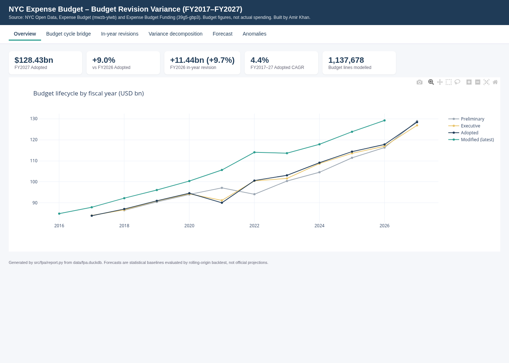
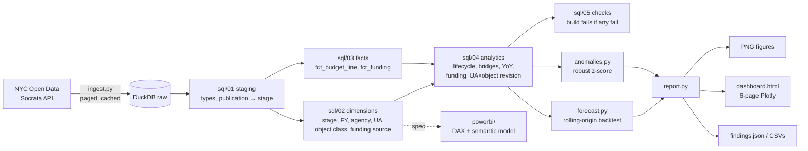

# NYC Budget Revision Variance: FP&A star schema, bridges, forecast backtests

An FP&A-style analysis of **how New York City's expense budget changes as it moves through the budget cycle**
(Preliminary → Executive → Adopted → in-year Modified) for FY2017–FY2027. It is built on the full line-level
NYC Open Data release: 1,137,678 budget lines and 446,040 funding-source facts.

The analysis covers four questions:

* Where does the money move between the Mayor's Preliminary budget and the Adopted budget?
* How much does the budget grow after adoption, and is that growth City-funded or Federal/State-funded?
* Which agencies and object classes drive the year-over-year change?
* How well do simple, transparent baselines forecast next year's Adopted total, judged by backtesting rather than by eye?

> **Scope, stated honestly:** these are **budget figures, not actual spending**. "Modified" means the modified
> budget as published in the following June's Adopted release. It is not a year-end close. The forecasts are
> statistical baselines, **not official projections**.



## Data source and terms
| Dataset | ID | Use |
|---|---|---|
| [Expense Budget](https://data.cityofnewyork.us/City-Government/Expense-Budget/mwzb-yiwb) | `mwzb-yiwb` | line level: agency × unit of appropriation × budget code × object code × publication |
| [Expense Budget Funding](https://data.cityofnewyork.us/City-Government/Expense-Budget-Funding/39g5-gbp3) | `39g5-gbp3` | unit of appropriation × funding source (City, Federal, State, Intra-city, ...) × publication |

Published by the NYC Office of Management and Budget on NYC Open Data, under the
[NYC Open Data Terms of Use](https://opendata.cityofnewyork.us/overview/#termsofuse). The data is pulled through the
public Socrata API with no key, using deterministic paging on `:id`. Raw extracts are cached in `data/` (git-ignored) and are not
redistributed in this repo.

**Source quirk this model handles:** a row for fiscal year N carries `financial_plan_amount` for FY N, but
`adopted_budget_amount` and `current_modified_budget_amount` refer to **FY N-1**. FY N's in-year revision
therefore has to be read from the FY N+1 Adopted publication. A warehouse check confirms that the restated prior-year
adopted amount equals that year's Adopted plan to within $1.

## Architecture


**Star schema (`mart`):** `fct_budget_line` and `fct_funding` are the facts. `dim_budget_stage`, `dim_fiscal_year`, `dim_agency` (149),
`dim_unit_appropriation` (770), `dim_object_class` and `dim_funding_source` are the conformed dimensions.

**Warehouse checks (all 7 pass):**
* fact row count matches the raw row count;
* every publication is mapped to a stage;
* exactly one Adopted publication per FY;
* the restated prior-year adopted amount ties to the Adopted plan;
* funding total equals budget total per publication (within 0.5%);
* agency keys are unique;
* no orphan units of appropriation.

**SAP analogy only:** for readers from an SAP background, the stages map roughly to budget versions (as in
SAP BPC/PSM-FM "plan versions"), the unit of appropriation maps to a funds centre / commitment item, and the funding source
maps to a fund. This is an analogy to aid reading. Nothing here uses or reproduces SAP.

## Findings (data pulled Oct 2026)
* **Growth:** the Adopted budget grew from **$83.88bn (FY2017) to $128.43bn (FY2027)**, a CAGR of 4.35%.
* **The budget always grows after adoption.** The in-year revision ranged from **+4.8% to +17.3%** of the Adopted
  budget. The peak was **FY2021: +$15.6bn on $90.03bn** (the pandemic year, with federal relief).
* **FY2026 in-year revision: $117.79bn → $129.23bn (+$11.44bn, +9.7%).**
  * By funding source: City +$6.69bn, Federal +$2.28bn, State +$1.69bn.
  * By agency: Education +$2.71bn, Social Services +$2.71bn, Debt Service +$1.61bn.
* **FY2027 budget cycle:** Preliminary $128.95bn → Executive $126.90bn → Adopted $128.43bn.
  * The largest Preliminary→Adopted moves were Debt Service −$1.92bn, Pension Contributions −$1.71bn and
    Citywide Savings Initiatives +$1.06bn.
* **FY2027 vs FY2026 Adopted (+$10.6bn, +9.0%):**
  * By agency: Education +$3.61bn, Social Services +$3.02bn, Debt Service +$2.49bn.
  * By object class: Social Services +$2.75bn, Contractual Services +$2.67bn.
* **Forecast backtest** (one-step-ahead forecast of the Adopted total, 8 rolling origins, FY2020–FY2027):

  | Model | MAPE |
  |---|---|
  | prelim_anchor (Preliminary × median Prelim→Adopted ratio) | **3.0%** |
  | drift | 3.55% |
  | log-linear trend | 3.74% |
  | naive | 5.39% |

  * FY2028 baselines:

    | Model | Forecast | 80% band (empirical error quantiles) |
    |---|---|---|
    | naive | $128.4bn | $128.6–141.1bn |
    | drift | $134.1bn | $129.3–142.6bn |
    | log trend | $128.6bn | $125.1–135.8bn |

  * prelim_anchor cannot forecast FY2028 until the FY2028 Preliminary budget is published (Jan/Feb 2027).
  * The naive band sits above its own point forecast. That is expected: 7 of the 8 naive backtest errors were
    under-forecasts in a growing series.
* **Anomalies:** 570 of 8,367 unit-of-appropriation × object-class lines were flagged. A line is flagged when its robust z-score is above 3.5 within
  its FY × object class, the revision is at least $10m and the base is at least $1m. The largest flag is FY2021 Miscellaneous fringe benefits,
  +$2.91bn (+70%). These are leads for review, not errors.

Figures are in `reports/figures/`. The interactive 6-page dashboard is `reports/dashboard.html`, with pages for Overview,
Budget cycle bridge, In-year revisions, Variance decomposition, Forecast and Anomalies, each with an FY selector.

## How to run
```bash
python -m venv .venv && source .venv/bin/activate
pip install -r requirements.txt
./run_all.sh            # or: make   (ingest is cached; ./run_all.sh --refresh to re-download)
```
The steps are ingest (about 1.1M rows from the public API), build the DuckDB warehouse and its checks, run pytest, then report.
Docker: `docker build -t nyc-fpa . && docker run --rm nyc-fpa`.
CI (GitHub Actions) runs unit tests on every push, then an end-to-end job that pulls live data and runs everything.

**Tests (15):**
* forecast models recover a known geometric series;
* the backtest uses only prior years;
* the forecast band is ordered;
* the robust z-score flags a planted outlier and ignores small bases;
* paging parameters are correct;
* warehouse integration: checks pass, the stage sequence is complete, the cycle bridge closes, funding sources sum to the total, and the Python waterfalls close.

## Power BI
`powerbi/measures.dax` (stage, bridge, in-year, YoY, funding and CAGR measures) and `powerbi/semantic_model.md`
(tables, relationships, modelling rules and page layout) are a **specification**. **No `.pbix` is included and the
DAX has not been validated in Power BI Desktop.** This repo was built on Linux without Power BI. The same logic is
implemented and tested in SQL and Python.

## Limitations
* Budget figures only. There are no actuals or encumbrances: Checkbook NYC spending data is not used.
* "Modified" is a June snapshot, not the final year-end modified budget.
* FY2016 has no Adopted publication in the release, and FY2017 has no Preliminary.
* The forecast uses 11 annual points with an 8-origin backtest. The bands are empirical and wide, and should not be relied on for decisions.
* The source re-codes agencies and units of appropriation over time. Bridges are at agency level, where codes are
  stable. UA-level comparisons across years should be treated with care.
* The anomaly thresholds are judgement calls, documented in `src/fpa/anomalies.py`.

## Reference repos and what was borrowed
| Repo | Borrowed |
|---|---|
| [microsoft/Analysis-Services](https://github.com/microsoft/Analysis-Services) | Best Practice Analyzer rule ideas used in `semantic_model.md` (DIVIDE, hidden keys, no bi-directional relationships) |
| [TabularEditor/BestPracticeRules](https://github.com/TabularEditor/BestPracticeRules) | Naming, display-folder and format-string conventions for the measure library |
| [Nixtla/statsforecast](https://github.com/Nixtla/statsforecast) | Rolling-origin cross-validation framing and naive/drift baselines (reimplemented in numpy, not imported) |
| [plotly/plotly.py](https://github.com/plotly/plotly.py) | Waterfall trace (`measure=relative/total`) used for all bridges |
| [duckdb/duckdb](https://github.com/duckdb/duckdb) | In-process warehouse; `FILTER` aggregates and `UNPIVOT` patterns from its docs |

## Author
Amir Khan. MIT License.
